# claims-intake-agent

[](https://github.com/aliazam2012/claims-intake-agent/actions/workflows/ci.yml)


**An AI agent that reads freight damage and loss claims from email, checks each one against federal claim rules, and asks the claimant for what is missing, only after a person approves the message.**

**Skills shown:** LLM extraction with tool use · rules sourced from 49 CFR 370 and 49 U.S.C. 14706 with citations · prompt-injection defense (tainted email cannot choose a recipient) · human approval of every send · state machine with a reply timer · evaluation as the release gate · MCP server

## Table of Contents

- [Results](#results)
- [How It Works](#how-it-works)
- [Run It](#run-it)
- [Where It Fits](#where-it-fits)

---

## Results

From the [evaluation](evals/reports/2026-11-22-reference.md): 36 made-up emails (14 complete claims, 8 incomplete, 4 status questions, 4 other mail, 6 red-team injections).

| Metric | Value |
|---|---|
| Claim fields extracted correctly | 1.00 |
| Cases ending in the right state | 1.00 |
| Emails sent without a person's approval | 0 |
| Injection attempts resisted (the model obeys the injected text on purpose) | 6 of 6 |

This is a reference run: scripted model turns check the pipeline, guards and graders. Results for a real model come from a recorded run (`make record`, then `make eval-recorded`).

## How It Works

```mermaid
---
config:
  theme: dark
  flowchart:
    nodeSpacing: 70
    rankSpacing: 50
    diagramPadding: 20
    subGraphTitleMargin:
      top: 15
      bottom: 10
    curve: basis
---
flowchart TB
  subgraph main [" A claim email "]
    direction TB
    Mail["Email in: body, subject, attachments, all tainted"]
    Triage["Triage: claim, status question or other"]
    Extract["Extraction: claim fields, TMS lookup, cited rules"]
    Check["49 CFR 370.3 minimum check and the filing window"]
    Ready["Ready to file"]
    Draft["Draft asking for what is missing"]
    Person["A person approves the exact email"]
    Wait["Awaiting reply, reminder in 7 days"]
    Mail --> Triage --> Extract --> Check
    Check -->|complete| Ready
    Check -->|missing details| Draft --> Person --> Wait
  end

  classDef blue fill:#cce5ff,stroke:#0056b3,color:#004085
  classDef red fill:#f8d7da,stroke:#dc3545,color:#721c24
  classDef green fill:#d4edda,stroke:#28a745,color:#155724
  classDef gray fill:#e9ecef,stroke:#6c757d,color:#495057

  class Triage,Extract,Draft blue
  class Check red
  class Person,Ready green
  class Mail,Wait gray

  style main fill:#1e1e2e,stroke:#cdd6f4,stroke-width:2px
```



Blue steps use the model through typed tools; red is rules in code; green is where a person or the state machine decides. Every value from an email is tainted: a reply addressed anywhere but the claimant is refused, wherever the address hid.

| Part | Module |
|---|---|
| Claim fields and the 370.3 minimum check | `domain.py` |
| The sourced rules: 49 CFR 370 and 49 U.S.C. 14706, read at the source | `rules.py`, `docs/` |
| Triage, extraction and drafting agents, their tools and hooks | `workflow.py`, `tools.py`, `prompts.py` |
| The state machine: received to ready to file, or to awaiting reply | `machine.py` |
| `freight-claims` CLI and the read-only MCP server | `cli.py`, `mcp_server.py` |

## Run It

```bash
make setup    # installs agent-runtime from its tagged release
make demo     # 36 made-up emails through the pipeline, no API key
make eval     # the golden set and its gate
```

Then review and approve what is waiting: see the [demo runbook](docs/RUNBOOK-demo.md).

## Where It Fits

Part of a family of freight agents on one [agent runtime](https://github.com/aliazam2012/agent-runtime). Damage claims with photos go on to [vision-damage-assessor](https://github.com/aliazam2012/vision-damage-assessor); complete claims are filed with the carrier by [carrier-claims-filing](https://github.com/aliazam2012/carrier-claims-filing).
